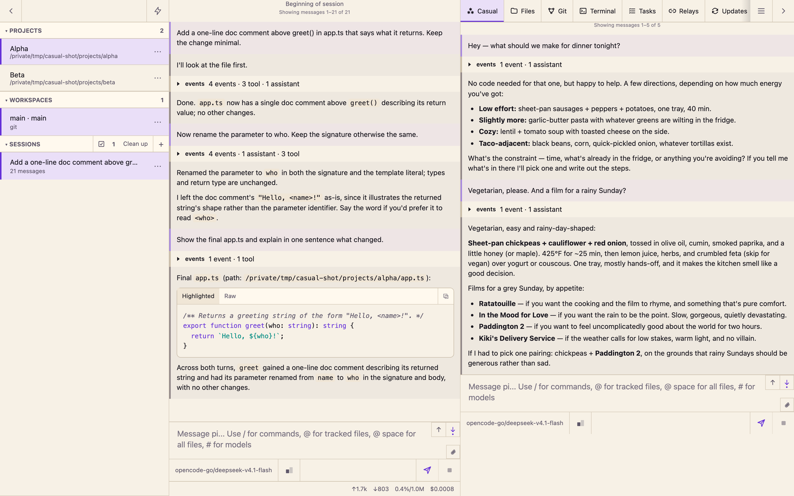
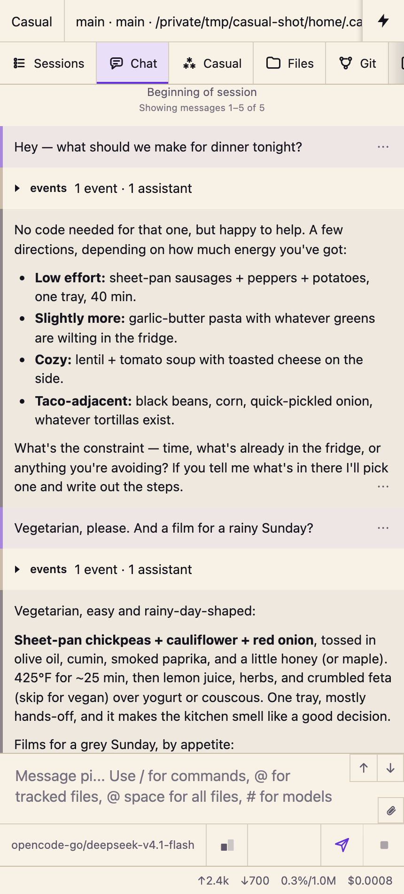

# pi-web-casual

A PI WEB plugin that adds one long-running conversation that is not attached to a repository.

**Status:** implemented (v1). Browser-only plugin: one project-free chat, opened from the Casual tab or the action palette. It has no server entry and needs no session-daemon restart.



## What Casual does

PI WEB organizes conversations around projects and workspaces. That is the right shape for code and a poor fit for the rest of the day: what to cook, naming a playlist, explaining an article, planning a weekend. Casual gives those conversations one home by reusing PI WEB's own project machinery: a hidden project at `~/.casual-pi-web` and a normal session inside it.

The chat is PI WEB's **native chat**, not a plugin reimplementation. Streaming, Markdown, tools, images, model selection, and compaction behave exactly as they do anywhere else, and the conversation is stored where PI WEB stores every other session.

It contributes:

- a **Casual** application tab;
- four palette actions: **Open Casual Chat**, **Open Casual Chat in Its Own Tab**, **New Casual Chat**, **Set Up Casual Chat**.

It behaves like this:

- **One conversation.** The **Casual** tab and **Open Casual Chat** reopen the remembered session from any project.
- **The Casual tab is only a chat.** The tab embeds the real PI WEB chat in a same-origin frame with that frame's navigation, header, and workspace column trimmed away, so a project chat in the main column keeps working next to it. There is no toolbar and no card around it; every control lives in the palette.
- **Hidden home.** The `Casual` project is filtered out of the **Projects** sidebar, including its row, the project count, and the collapsed-heading summary. It remains a real project for PI WEB: it appears in the **Change home** chooser, and its sessions appear in **Sessions** while it is selected.
- **New chat keeps history.** **New Casual Chat** creates another session in the same home and makes it the remembered one. The previous conversation stays in **Sessions**; Casual never deletes.
- **Self-repair.** Opening Casual resolves the home's workspaces and sessions and prefers the remembered session, so a stale or archived pointer is replaced by the newest live casual session instead of failing.
- **Automatic first run.** The first **Open chat** or palette open creates and trusts `~/.casual-pi-web`, starts a session, and reloads the page once into it. There is no **Add Project** step.

## Install

### Requirements

- PI WEB `1.202610.3` or newer (browser plugin API v4). Tested against `@jmfederico/pi-web` 1.202610.3.
- Node.js 22.19 or newer only if you build from source. Installing the published package needs no toolchain.
- No session-daemon restart at any point.

PI WEB has no install-time version gate for plugins, so an older host installs the package and then refuses it at activation. The browser console shows `PI WEB Casual requires PI WEB 1.202610.3 or newer`, and no Casual tab is registered.

### From GitHub

1. Open PI WEB → **Settings → Pi packages**.
2. Install `https://github.com/paradise-runner/pi-web-casual`.
3. Enable **Casual** under **Settings → PI WEB plugins** if it is not already on.
4. Reload the browser page.

### From a release tarball

Download `pi-web-casual-0.1.0.tgz` from [Releases](https://github.com/paradise-runner/pi-web-casual/releases) and install that file under **Settings → Pi packages**, then enable **Casual** and reload.

### From npm

The package is prepared as `pi-web-casual` but is not published yet. Use GitHub or a tarball until it is. Maintainers: see [docs/how-it-works.md](docs/how-it-works.md#releasing).

### From source

See [CONTRIBUTING.md](CONTRIBUTING.md#development-setup). PI WEB does not compile TypeScript for local packages, so a checkout must be built before it is linked.

## First run

1. Open the **Casual** tab, or **Actions → Casual → Open Casual Chat**.
2. Casual creates and trusts `~/.casual-pi-web`, starts the first session, and reloads the page once into the chat.
3. Type in the normal composer.

The reload is one-time. PI WEB has no plugin API for registering a project, so Casual uses the host's own same-origin project and session endpoints for setup ([docs/how-it-works.md](docs/how-it-works.md#first-run)).

If those requests are unreachable, the panel shows a setup card instead: add `~/.casual-pi-web` yourself through **Add Project**, or choose an already-registered project as the home.



## Use

| Task | Where |
| --- | --- |
| Chat casually next to your project | The **Casual** tab — it embeds the chat and leaves the project column alone |
| Keep a project chat and Casual open as separate tabs | **Actions → Casual → Open Casual Chat in Its Own Tab** |
| Open the conversation in this tab, full view | **Open chat** on the Casual card, or **Actions → Casual → Open Casual Chat** |
| Start a new conversation | **Actions → Casual → New Casual Chat**, or **New chat** on the Casual card |
| Recover a stale link | **Reset link** on the Casual card |
| Pick a different home folder | **Change home** on the Casual card |

The **Casual** tab never redirects you into the host chat view. It shows the card, and once a conversation is remembered it embeds that conversation directly. Setup and error states keep their own card with the controls needed to recover.

The **Casual** tab is a view of its own: it always shows the card and never redirects you into the chat. Nothing opens the conversation except **Open chat** on the card or a palette action. The card reports where you left off — the remembered session's name and location — and carries the controls that only make sense there.

While the conversation is open, the **Casual** project is the selected project, so its sessions are visible in **Sessions** like any other project's.

## Limits (v1)

- **One conversation.** No topics, folders, pins, or per-topic sessions. A new chat is a sibling session in the same home, not a new space.
- **The separate window is a browser tab.** The palette action opens a named window and reuses it; a popup blocker, or no casual session yet, falls back to opening the conversation in the current tab, and the window is closed like any other tab.
- **One home per machine.** The home folder is fixed at `~/.casual-pi-web` unless you run **Change home**, and the remembered project/workspace/session pointer is stored per machine in `localStorage` under `pi-web-casual:store:v2`. A second machine finds or creates its own casual session.
- **No settings pane.** PI WEB's plugin API has no Settings contribution, so the home folder and pointer are changed through the card's controls, not through configuration.
- **Controls live in the palette.** Once a conversation is remembered the Casual tab has no buttons at all, so **Open**, **Open in Its Own Tab**, **New**, **Reset Casual Link**, **Change Casual Home**, and **Set Up** are palette actions. The card's buttons appear only in the states that show the card.
- **The embedded chat is framed, not native to the panel.** PI WEB's plugin API exposes no transcript component, so the Casual tab embeds the app's chat route in a same-origin frame and hides that frame's chrome. The frame is supervised, not trimmed once: it boots its own SPA, so the chrome keeps being hidden as the frame renders. A frame is also a second client instance with its own daemon connection.
- **Best-effort chrome.** PI WEB has no contribution point for hiding a project row or for a chat-only layout, so the hidden row and the embedded frame's chrome trimming depend on PI WEB's private shadow DOM. If an update changes that markup, the Casual tab and the palette keep working and the selectors need work in [`src/browser/dom.ts`](src/browser/dom.ts).
- **Project registration is not public API.** First run uses the host's own endpoints. If PI WEB changes them, first run falls back to the setup card.
- **API v4 only, PI WEB `1.202610.3` or newer.** Older hosts accept the package but Casual refuses to activate, because they lack application panels, the selection service, and project discovery. PI WEB `1.202610.6+` logs a deprecation warning for every API-v4 plugin, including its own bundled plugins. Moving to API v5 would drop `1.202610.3` support.
- **No deletion.** Casual does not delete sessions, workspaces, or the home project. Manage history in **Sessions**.
- **No telemetry.** No analytics, no third-party calls, no server process. Messages go to the model provider you configured for PI WEB.

## How it runs

A browser-only PI WEB plugin package. There is no server entry, no Pi extension, and no agent client: the plugin resolves the home project, remembers a session for each side of the toggle, and navigates into PI WEB's native chat.

- Browser bundle in `dist/browser`, served by PI WEB directly from the installed package.
- Browser API v4, with the public **catalog** used on `1.202610.6+` and the selection service on `1.202610.3`; activation throws on hosts that lack the selection service.
- Per-machine pointer in `localStorage` (`pi-web-casual:store:v2`), holding the casual project, workspace, and session.
- Shadow-DOM integration isolated in `src/browser/dom.ts`.

| Change | Action |
| --- | --- |
| Browser bundle or panel | `npm run build`, reload the page |
| `package.json` `piWeb` metadata | Reload the page; no daemon restart |
| Separate Casual window | Already open — reload it, or close it and open Casual again |
| Home folder or remembered session | Nothing to rebuild — use the card controls or `localStorage` |

Detail, including the bootstrap requests, discovery order, explicit-open intent, and shadow-DOM selectors: [docs/how-it-works.md](docs/how-it-works.md).

## Development

```sh
npm install --ignore-scripts
npm run typecheck
npm run build
```

`--ignore-scripts` skips building the native dependencies of the PI WEB host package; this project only consumes its TypeScript declarations. There is no test suite yet; the manual checklist lives in [CONTRIBUTING.md](CONTRIBUTING.md#manual-test-checklist).

The generated `dist/browser` files are committed because PI WEB serves them from the installed package. CI verifies they match source.

## Contributing

Issues and pull requests are welcome. Start with [CONTRIBUTING.md](CONTRIBUTING.md), follow the [Code of Conduct](CODE_OF_CONDUCT.md), and report security issues as described in [SECURITY.md](SECURITY.md).

## Decisions

- [ADR 0001: One long-running conversation](docs/adr/0001-one-long-running-conversation.md)
- [ADR 0002: The chat is PI WEB's native chat](docs/adr/0002-native-chat-not-an-agent-client.md)
- [ADR 0003: Browser-only, with first-run bootstrap through host endpoints](docs/adr/0003-browser-only-bootstrap-through-host-endpoints.md)
- [ADR 0004: Stay on browser plugin API v4](docs/adr/0004-stay-on-browser-plugin-api-v4.md)
- [ADR 0005: Best-effort private shadow-DOM integration](docs/adr/0005-best-effort-private-shadow-dom.md)
- [ADR 0006: The Asterism toggles between the project chat and Casual](docs/adr/0006-asterism-toggles-between-project-and-casual.md) *(superseded)*
- [ADR 0007: Casual opens in its own browser tab](docs/adr/0007-casual-opens-in-its-own-window.md)
- [ADR 0008: The Casual panel embeds the chat in a same-origin frame](docs/adr/0008-panel-embeds-the-chat-in-a-same-origin-frame.md)
- [ADR 0009: The Casual tab replaces the header button](docs/adr/0009-the-tab-replaces-the-header-button.md)
- [Vocabulary](GLOSSARY.md)
- [Using Casual](docs/using-casual.md)
- [How Casual works](docs/how-it-works.md)

## Related

- [PI WEB](https://pi-web.dev/) — the web UI that hosts Casual.
- [PI WEB plugin documentation](https://pi-web.dev/plugins) — supported contracts, installation, and reload rules.
- [Pi coding agent](https://pi.dev/) — the agent that powers PI WEB conversations.

## License

[MIT](LICENSE) © 2026 Edward Champion.
